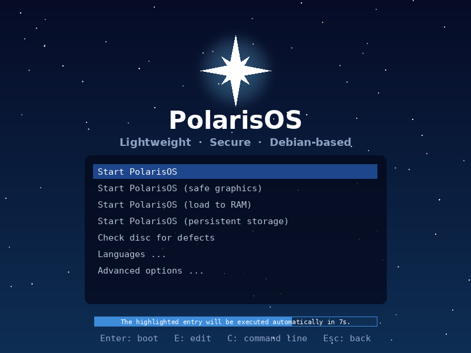

<p align="center">
  
</p>

<h1 align="center">PolarisOS</h1>

<p align="center">
  Distribución Linux ligera, segura y fácil de usar, basada en Debian 13.<br>
  <a href="https://github.com/SharifGiraldoo/PolarisOS/actions/workflows/construir-iso.yml">
    
  </a>
</p>

<p align="center">
  
</p>

<p align="center">
  
</p>

<p align="center"><strong>Free as in Freedom</strong></p>

---

## ¿Por qué PolarisOS?

PolarisOS nace como un proyecto personal **por amor al software libre**: la
convicción de que el software que usamos todos los días debería poder
estudiarse, compartirse y mejorarse en comunidad.

**Polaris** es la Estrella Polar, la que durante siglos guió a navegantes y
viajeros porque siempre está en el mismo lugar del cielo. El proyecto toma ese
nombre con una idea sencilla: ser un punto de referencia estable y confiable
para quien quiere empezar en Linux o darle una segunda vida a un computador que
otros sistemas ya dejaron atrás.

Sus principios:

- **Libertad:** todo el código está a la vista y bajo la licencia GPL-3.0.
- **Ligereza:** funciona en equipos con 2 GB de RAM, sin sacrificar un
  escritorio completo.
- **Seguridad por defecto:** protegido desde el primer arranque, sin pasos
  extra para el usuario.
- **Aprender construyendo:** cada decisión técnica está documentada para que
  cualquiera pueda entender cómo se hace una distribución Linux.

## Free as in Freedom

En inglés, *free* significa tanto "gratis" como "libre". La frase **"Free as
in Freedom"** aclara de cuál se trata: el software libre se refiere a la
**libertad** de los usuarios, no al precio.

Un programa es software libre cuando respeta cuatro libertades:

| Libertad | Qué te permite |
|---|---|
| **0** | Usar el programa con cualquier propósito |
| **1** | Estudiar cómo funciona y adaptarlo a tus necesidades (para eso necesitas el código fuente) |
| **2** | Compartir copias para ayudar a otras personas |
| **3** | Mejorar el programa y publicar tus mejoras para que toda la comunidad se beneficie |

PolarisOS protege esas libertades de dos maneras:

- Su código se publica bajo la **GPL-3.0**, una licencia *copyleft*: quien
  distribuya una versión modificada debe compartirla con las mismas libertades.
- Se construye sobre **Debian**, uno de los proyectos de software libre más
  antiguos del mundo, mantenido por una comunidad de voluntarios y guiado por
  su propio compromiso con el software libre.

## Características

| Requisito | Cómo lo cumple PolarisOS |
|---|---|
| **Ligera** (≤ 2 GB de RAM) | XFCE sin extras, `--apt-recommends false`, zram con zstd, earlyoom y servicios bajo demanda. Meta: ≤ 1 GB en reposo (sesión live) |
| **Funciona en muchos equipos** | Arranque BIOS y UEFI, firmware para Wi-Fi y gráficos comunes, microcódigo Intel/AMD |
| **Interfaz gráfica** | Escritorio XFCE, LightDM, pantalla de arranque Plymouth e instalador gráfico Calamares |
| **ISO profesional** | Menú de arranque propio (BIOS y UEFI) con gráficos seguros, carga en RAM, persistencia, verificación del medio, prueba de memoria e idiomas; inglés por defecto |
| **Instalar paquetes** | `apt` + Synaptic, con acceso a los repositorios completos de Debian; impresión, Bluetooth y códecs multimedia incluidos |
| **Segura y confiable** | Secure Boot, UFW activo, AppArmor, actualizaciones de seguridad automáticas, endurecimiento del kernel y ISO verificable con SHA256 + GPG |

## Requisitos mínimos

- Procesador de 64 bits (x86_64)
- 2 GB de RAM
- 20 GB de disco para instalar

## Descargar

Descarga la última ISO desde **[Releases](https://github.com/SharifGiraldoo/PolarisOS/releases)** y verifícala:

```bash
sha256sum -c SHA256SUMS --ignore-missing
gpg --verify SHA256SUMS.asc SHA256SUMS
```

## Construir desde el código

```bash
git clone https://github.com/SharifGiraldoo/PolarisOS.git
cd PolarisOS
sudo apt install podman make qemu-system-x86 qemu-utils ovmf
make iso            # construye la ISO en un contenedor Debian 13
make probar-uefi    # la prueba en una máquina virtual con 2 GB de RAM
```

Escribe `make` para ver todas las tareas disponibles.

📘 **La guía completa, paso a paso, está en [docs/GUIA.md](docs/GUIA.md).**

## Estructura del repositorio

```
auto/                     configuración de live-build (lb config / build / clean)
config/package-lists/     paquetes que lleva la ISO
config/hooks/normal/      ajustes de seguridad, rendimiento e instalador
config/includes.chroot/   archivos que se copian tal cual al sistema
packages/polaris-branding paquete Debian con la identidad de PolarisOS
scripts/                  construir, probar en QEMU y firmar releases
assets/                   generador del arte (logo y fondos)
.github/workflows/        integración continua y publicación de releases
docs/                     documentación
```

## Contribuir

Lee [CONTRIBUTING.md](CONTRIBUTING.md). Para reportar vulnerabilidades, consulta [SECURITY.md](SECURITY.md).

## Licencia

Los scripts y la configuración de este repositorio se distribuyen bajo la
[GPL-3.0](LICENSE). Cada paquete incluido en la ISO conserva su propia licencia
(consulta `/usr/share/doc/*/copyright` dentro del sistema).

PolarisOS es un proyecto independiente basado en Debian y no está afiliado al
Proyecto Debian. Debian es una marca registrada de Software in the Public
Interest, Inc.
